# Jarvis-Bot — a theme for Clawd on Desk

A blue desk robot for [Clawd on Desk](https://github.com/rullerzhou-afk/clawd-on-desk), the desktop pet that reacts to what your coding agent (Claude Code, Codex, …) is doing.

  
  
  
  

## What it does

| Agent state | Jarvis-Bot |
| --- | --- |
| Idle | Pupils follow your cursor, red lightsaber glows and dims through a red spectrum |
| Thinking | Saber holstered, glowing thought sparks pop up around the head |
| Working (coding) | Saber holstered, types on a mechanical keyboard while **Matrix rain** runs on its chest monitor |
| Task done | Short victory dance with confetti and a speech bubble (*Erledigt! / Fertig! / Top! / Genial!*) |
| Notification | Ringing bell and a speech bubble |
| Error | Red alarm visor and sparks |
| Sleeping / waking | Lies down with floating *Z*s, then flickers back on |
| Every now and then | Goes a little crazy for 3 seconds |
| Click | Surprised reaction |
| Drag & shake | Gets dizzy — and after 2 seconds throws up green oil and screws |

  
  
  
  

Everything is hand-written animated SVG — no raster images, about 50 KB in total.

## Install

1. Download **`jarvis-bot-1.1.1.clawd-theme.zip`** from the [latest release](../../releases/latest).
2. In Clawd open **Settings → Theme → Import Clawd theme package (.zip)** and pick the file.
3. Select **Jarvis-Bot** under *User Themes*.

Or unpack the `jarvis-bot` folder into your Clawd themes folder (**Settings → Theme → Open themes folder**) and click **Refresh themes**.

> **Tip:** If you edit the SVGs yourself, Clawd caches themes. Delete `theme-cache/jarvis-bot` in Clawd's data folder and click **Refresh themes**, otherwise you keep seeing the old version.

## Notes for theme authors

A few things I learned building this, in case they help you:

- **Never put a CSS `transform` animation on an element that also has a `transform` attribute** (or that Clawd moves for eye tracking). A running CSS animation overrides the attribute every frame — the element jumps to the origin or stops following the cursor. Put position and animation on separate nested groups.
- Eye tracking uses `eyeTracking.trackingLayers` (pupils, eyes, head with their own range and easing). Clawd snaps offsets to quarter steps; on a small viewBox that looks jerky, so the tracked groups sit inside a `scale(0.1)` / `scale(10)` sandwich for ten times finer movement.

## Deutsch

Ein blauer Schreibtisch-Roboter für **Clawd on Desk**. Installation: Zip aus dem [neuesten Release](../../releases/latest) laden, in Clawd unter **Einstellungen → Theme → „Import Clawd theme package (.zip)"** importieren und **Jarvis-Bot** auswählen.

## License

[MIT](LICENSE) © 2026 martin999-dotcom. Not affiliated with Clawd on Desk or its author.
